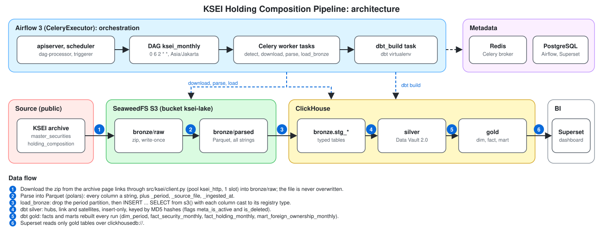
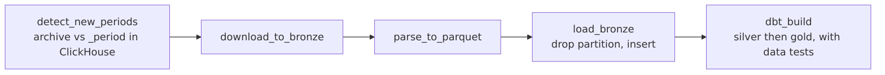
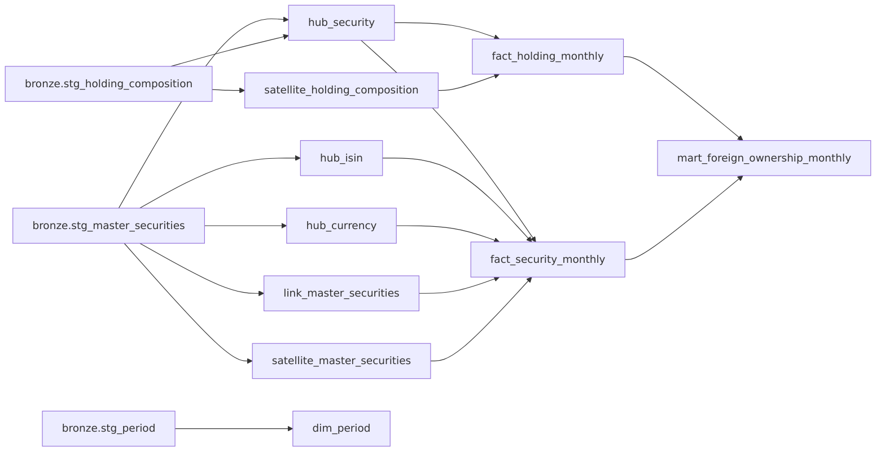
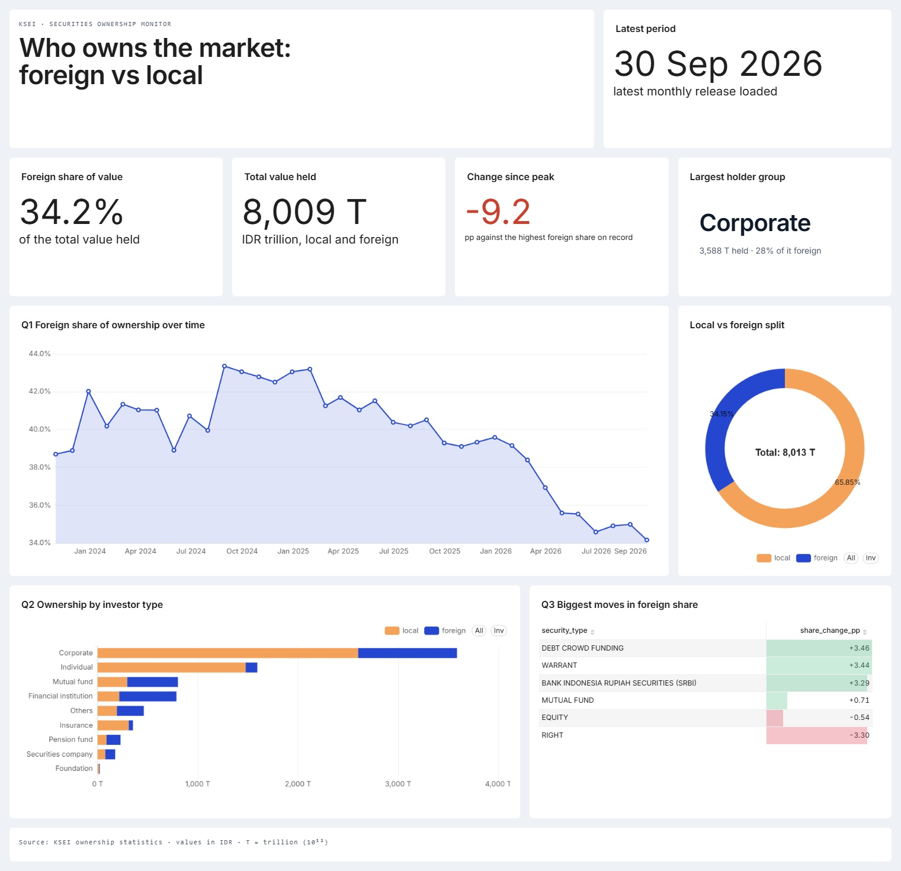

# KSEI Holding Composition Pipeline

[](https://github.com/juliuschaesar-dev/ksei-holding-pipeline/actions/workflows/ci.yml)

A portfolio data pipeline that collects two public KSEI datasets monthly, the
securities master file and the securities holding composition (local vs
foreign ownership). It stores them in a medallion architecture (bronze, silver,
gold), models them with dbt on ClickHouse, and serves dashboards in Superset.
Everything runs in Docker Compose.

## What it answers

- **Q1** How has foreign vs local ownership changed over time?
- **Q2** How is ownership composed by investor type and by security type?
- **Q3** What changed month over month?

The questions and the models behind each chart are in [docs/dashboard-questions.md](docs/dashboard-questions.md).
The data source (pages, file layout, columns): [docs/data-source.md](docs/data-source.md).

## Disclaimer

This project is **not affiliated with KSEI** (Kustodian Sentral Efek
Indonesia). All data belongs to KSEI. This repository is for educational and
portfolio use only and does not redistribute KSEI data.

## Architecture



DAG tasks, per dataset and per new period:



Silver and gold models:



Airflow 3 (CeleryExecutor) orchestrates. Celery is here by explicit choice, not
because the workload needs it. PostgreSQL holds metadata only; the warehouse is ClickHouse.
Layers, vault design and gold models: [docs/architecture.md](docs/architecture.md).

## Stack

Airflow 3.3 (Celery, Redis), PostgreSQL 18 (metadata only), SeaweedFS (S3 bronze files), ClickHouse 26.8
(warehouse), dbt-core 1.12 with dbt-clickhouse, Superset 6.1, Python 3.14 (`httpx`, `boto3`, `polars`),
GitHub Actions (CI). Every version is pinned in [docs/versions.md](docs/versions.md).

## Design decisions and trade-offs

| Decision | Why | Cost |
|---|---|---|
| ClickHouse as the warehouse | Columnar and fast for the wide monthly snapshots; plain `MergeTree` tables keep dbt simple | No transactions or cheap updates, so the vault only appends and flags rows with one lightweight `UPDATE` |
| Celery executor | A chosen part of the portfolio, to show a distributed Airflow; the download pool `ksei_http` (1 slot) is what limits load on KSEI | More moving parts (Redis, workers) than this workload needs |
| No Spark | The files are small (pipe-delimited, one per month); `polars` and ClickHouse are enough | Would not scale to a very large source, which this is not |
| Data Vault 2.0 in silver | Changed attributes keep their history without rewriting anything, and loads need no ordering (MD5 keys) | More tables than a star schema; gold hides that from the dashboard |
| No security dimension | KSEI is the only source of security attributes and reformats them over time (one code, three issuer spellings), so each period keeps what it was published with | Descriptions repeat per period in `fact_security_monthly` |
| Typed bronze tables, all-strings files | A period can always be reloaded from S3; the tables hold real types | An empty optional cell becomes a type default, and gold restores NULL |
| dbt in its own virtualenv, run by `@task.bash` | Keeps dbt's dependencies out of Airflow's constraints; no Cosmos | One more virtualenv in the image |
| Superset assets in the repo | The dashboard is imported on start, never configured by hand | Re-export after every UI edit (`make superset-export`) |

## Dashboard

Imported on start at `/superset/dashboard/ksei-ownership/` (profile `full`).



## Quickstart

Requires Docker with about 8 GB RAM and [uv](https://docs.astral.sh/uv/). `make` is optional:
every `make` target below is a thin wrapper, and the plain commands are listed next to it.

```bash
make env                 # a .env with random secrets (never overwrites an existing one)
```

Or copy `.env.example` to `.env` and fill in the values yourself.

| Task | With make | Without make |
|---|---|---|
| Start the core services | `make up` | `docker compose up -d --build --wait` |
| Start them plus Superset | `make up PROFILE=full` | `docker compose --profile full up -d --build --wait` |
| Stop everything | `make down` | `docker compose down` (add `--profile full` to include Superset) |
| Follow a service's logs | `make logs SERVICE=airflow-worker` | `docker compose logs -f airflow-worker` |
| Service status | | `docker compose ps` |

The first start also runs the one-shot `period-init` service, which downloads the period
calendar (a static file, `PERIOD_SOURCE_URL`) into SeaweedFS and ClickHouse; it needs internet
access and does nothing on later starts.

Then open Airflow (below) and unpause the `ksei_monthly` DAG. Its first run downloads and loads every
period the KSEI archive offers; later runs, on the 2nd of each month, load only what is new.

| Service | URL |
|---|---|
| Airflow | http://localhost:8080 |
| ClickHouse HTTP | http://localhost:8123 |
| SeaweedFS S3 | http://localhost:8333 |
| Superset (`full`) | http://localhost:8088 (dashboard: `/superset/dashboard/ksei-ownership/`) |

## Development

`uv sync` installs the tools. Rules and conventions are in [AGENTS.md](AGENTS.md); pinned versions
in [docs/versions.md](docs/versions.md).

| Task | With make | Without make |
|---|---|---|
| Lint (ruff and sqlfluff) | `make lint` | `uv run ruff check .`, `uv run ruff format --check .`, `uv run sqlfluff lint dbt` |
| Unit tests with the coverage gate | `make test` | `uv run pytest -m "not integration and not smoke" --cov` |
| DAG tests (inside the Airflow image) | `make test-dags` | see below |
| Integration tests (needs the stack up) | `make test-integration` | `uv run pytest -m integration` |
| Smoke tests (needs the stack up) | `make test-smoke` | `uv run pytest -m smoke` |
| Build the dbt models | `make dbt-build` | `uv run python tools/dbt.py build --exclude "test_type:unit"` |
| dbt unit and data tests | `make dbt-test` | `uv run python tools/dbt.py test` |
| Generate dbt docs | `make dbt-docs` | `uv run python tools/dbt.py docs generate` |
| Regenerate the dbt hash fixtures | `make dbt-fixtures` | `uv run python tools/generate_dbt_unit_tests.py` |
| Re-export the Superset dashboard | `make superset-export` | `uv run python superset/export_assets.py` |
| Build the images (Superset too with `PROFILE=full`) | `make images` | `docker compose build` |
| Scan the git history for secrets (gitleaks) | `make scan-secrets` | see the `Makefile` |
| Scan the built images (trivy) | `make scan-images` | see the `Makefile` |

CI runs these same targets; failures and the GitHub setup are in [docs/runbook.md](docs/runbook.md).

DAG tests need Airflow, so they run in the Airflow image against the working tree:

```bash
docker compose build airflow-init
docker run --rm -v "$PWD:/workspace" -w /workspace -e PYTHONPATH=/workspace/src \
  -e AIRFLOW__CORE__LOAD_EXAMPLES=false --entrypoint bash ksei-airflow:local \
  -c "uv pip install -q pytest==9.1.1 && python -m pytest tests/dags -q -p no:cacheprovider"
```
