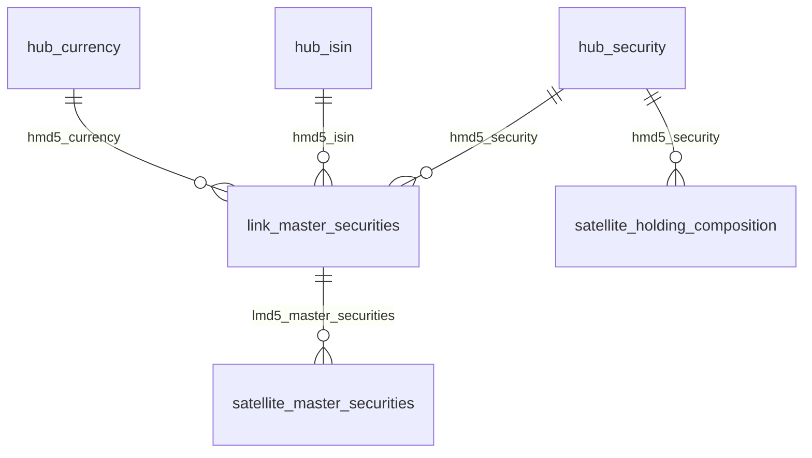

# Architecture

```
KSEI archive -> SeaweedFS bronze/raw (zip) -> bronze/parsed (Parquet, all strings)
             -> ClickHouse bronze.stg_* (typed) -> dbt silver (Data Vault 2.0)
             -> dbt gold (facts and marts) -> Superset

period calendar (static file) -> SeaweedFS bronze/period -> ClickHouse bronze.stg_period
             -> dbt gold dim_period (no silver)
```

Details of the source and file layout: [data-source.md](data-source.md). Questions the gold
layer answers: [dashboard-questions.md](dashboard-questions.md). The silver design follows the
`datavault-dbt` reference project.

## Layers

| Layer | Where | What |
|---|---|---|
| Bronze files | SeaweedFS `bronze/<dataset>/{raw,parsed}/year=YYYY/month=MM/` | the original zip, and a Parquet copy with every column as a string plus lineage |
| Bronze tables | ClickHouse `bronze.stg_holding_composition`, `bronze.stg_master_securities` | typed (String, Int64, Float64, Date, DateTime); one partition per period |
| Reference | SeaweedFS `bronze/period/{raw,parsed}/`, ClickHouse `bronze.stg_period` | the period calendar: one static file, loaded once and in full, typed like the other bronze tables |
| Silver | ClickHouse `silver.*` | the raw Data Vault 2.0: hubs, a link and satellites, keyed by MD5 hashes; no business rules |
| Gold | ClickHouse `gold.*` | facts and marts projected from the vault, where values are cleaned |

## Silver: the vault

Hubs hold business keys, the link holds the relationship between them, satellites hold
everything descriptive. Joins are on MD5 hashes, so no structure has to load before another.



| Model | Business key | Notes |
|---|---|---|
| `hub_security` | `code` | loaded from the master file and the holding file together: about 280 codes exist only in one of them |
| `hub_isin` | `isin_code` | the identity of an instrument; only the master file carries ISINs |
| `hub_currency` | `currency` | a currency code (IDR, USD); only the master file carries it |
| `link_master_securities` | `code` + `isin_code` + `currency` | a code, the ISIN it stands for and the currency it is denominated in; KSEI occasionally reuses one code for two ISINs, so a code can have several rows |
| `satellite_master_securities` | link key + `period` | the other master file attributes of that combination (status, dates, interest, amounts), one version history per period; the currency is not repeated, it is the hub |
| `satellite_holding_composition` | `hub_security` key + `period` | price, shares outstanding, local and foreign quantities by investor type; hangs off the hub because the file has no ISIN |

**The reporting period is not a hub.** A release date is a point in time, not a business entity
(the `datavault-dbt` reference does not make its calendar a hub either). Both files are monthly
snapshots, so the period is a child key of the satellites: multi-active satellites with one
version history per period. The file's own `Date` column always equals the period, so the satellites do
not repeat it as a payload column (it stays in bronze).

- Every structure is one call to `dv_hub`, `dv_link` or `dv_satellite` (`dbt/macros/datavault/`).
- **Append-only data, two bookkeeping flags.** A satellite row is added whenever the payload hash
  differs from the version currently in force, so a change A -> B -> A is recorded. Each row carries
  `meta_is_active` (1 for the version in force) and `is_deleted`, kept current by two post-hooks:
  - `dv_deactivate_superseded` sets `meta_is_active = 0` on the rows a newer version supersedes. It
    uses ClickHouse's lightweight `UPDATE`, which touches only those rows and is visible at once.
  - `dv_track_deletions` inserts a marker row (`is_deleted = 1`) for a grain that is in force but
    no longer in the source (bronze replaces a whole period when it is reloaded, so a row that
    vanishes from a reloaded period really has left the source). If the grain comes back, the
    loader adds a normal row with `is_deleted = 0`; nothing special is needed.
  - Hubs and links never delete: a key that leaves the source stays. Readers use
    `dv_satellite_current` (`meta_is_active = 1 and is_deleted = 0`), so a deleted grain drops out
    of the security fact and the holding fact.
- Hash keys are `lower(hex(MD5(...)))` over the trimmed business keys, joined with `||`, so
  `('AB', 'C')` and `('A', 'BC')` differ; an empty part becomes `^^`.
- Business keys in hubs and the link are stored as text. The period child key keeps its `Date` type.

## Gold: facts and marts

```
bronze.stg_period                                                                         -> dim_period
hub_security, hub_isin, hub_currency, link_master_securities, satellite_master_securities -> fact_security_monthly
hub_security, satellite_holding_composition                                               -> fact_holding_monthly
fact_security_monthly + fact_holding_monthly                                             -> mart_foreign_ownership_monthly
fact_holding_monthly                                                                      -> mart_investor_type_monthly
```

Gold reads only the vault, never bronze, with one exception: `dim_period`. The facts and marts carry
`is_latest_period` (1 on the newest period of the table), and `fact_holding_monthly` carries the name of
each investor type (`investor_type_name`, from the `investor_types` var), so a dashboard never works either out. It is rebuilt as tables on every run. `fact_security_monthly`
keeps one row per period and code (the lowest ISIN when a code is reused) with the description, type,
issuer and the attributes that change from month to month (status, currency, dates, interest). There is
no security dimension: the master file is the only source of these attributes, and KSEI reformats
descriptions and issuer names over time (SMBR has three issuer spellings), so each period keeps the
text it was published with. Gold cleans text and spellings, and restores NULL where bronze stored a default. Every column is a plain `String`, `Int64`, `Float64`, `Date`
or `DateTime`. The mart takes the security type from the holding file (`fact_holding_monthly`) and only the currency from `fact_security_monthly`. The facts keep every measure of their source file: `fact_security_monthly` all the numeric columns of the master file, and `fact_holding_monthly` the quantity per investor type plus `sec_num` and the source total of the residency (`total_quantity`). `fact_holding_monthly` unpivots the 18 quantity
columns into one row per period, security, local/foreign and investor type, without zero rows.

## The period calendar

`gold.dim_period` has one row per day from 2000-01-01 to 2050-12-31 (18,628 rows) and is the
calendar for the `period` of the facts: join `date_actual` to it to group by month, quarter
or year. It skips silver on purpose: a calendar is reference data, not a business entity of
KSEI, so there is nothing to version in a vault.

- **Source:** a static CSV at `PERIOD_SOURCE_URL` (see [data-source.md](data-source.md)). It is
  not a KSEI file, so it does not go through the KSEI client.
- **Load:** the `period-init` Compose service runs `infra/init_period.py` on every start of
  the stack. It downloads the file only when `bronze/period/raw/raw_period.csv` is missing,
  checks the header before storing anything (the raw object is write-once), writes the
  all-strings Parquet next to it and loads the typed table only when it is empty. A later
  start finds everything in place and changes nothing.
- **Gold:** every column of `bronze.stg_period` (lineage included), under its own name; the one day without an ISO week in
  the source (2000-09-11) becomes NULL.

## Delivery

`ci.yml` (pull requests and `main`) lints, runs the unit and DAG tests, builds the images, scans for
secrets and runs the integration, smoke and dbt tests against the full stack. It only calls `make` targets. Details: [runbook.md](runbook.md).

## Tests

- Unit tests (given/expect) for every vault macro and gold model, including the satellite
  A -> B -> A case; generic tests on keys, relationships and categories.
- Reconciliation tests: the fact adds up to bronze totals per period and residency, and the vault
  has exactly as many link and satellite rows as bronze has keys and rows.
- Integration tests build the models from synthetic periods loaded through the pipeline, and
  check that a rerun and a full rebuild leave every table identical.

## Orchestration

`period-init` (Compose, once per start, not Airflow) loads the period calendar. `ksei_monthly` (Airflow): per dataset `detect_new_periods` -> `download_to_bronze` (pool
`ksei_http`) -> `parse_to_parquet` -> `load_bronze`, then one `dbt_build` after both datasets.
